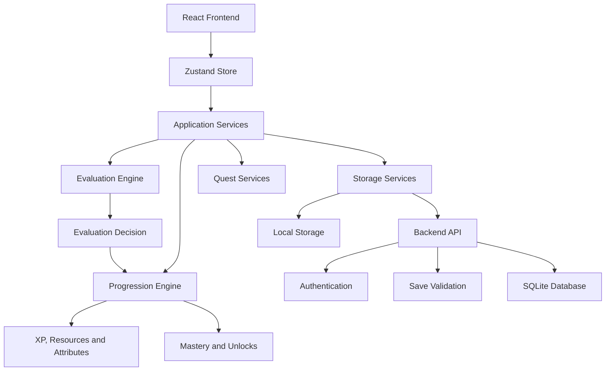
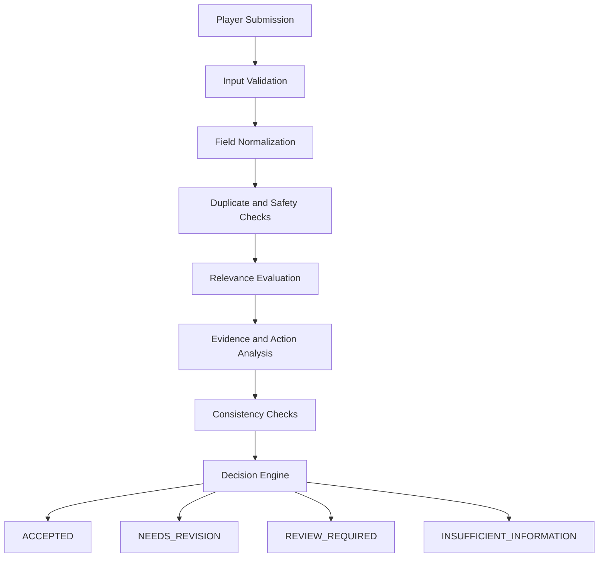
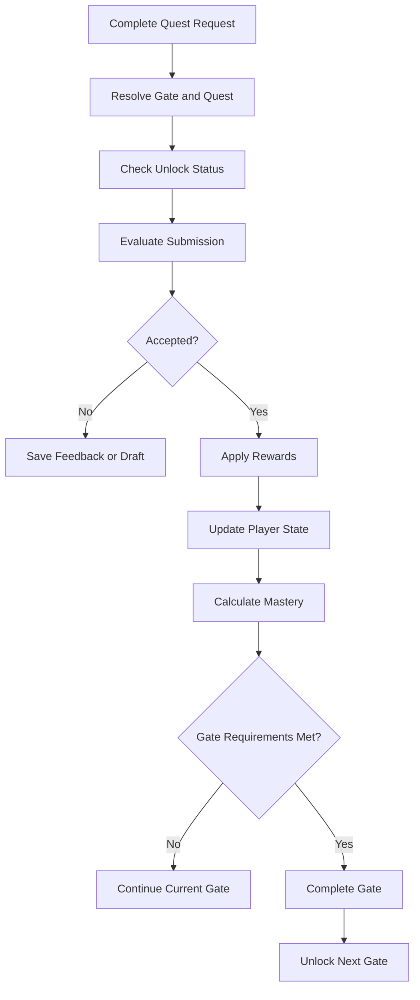
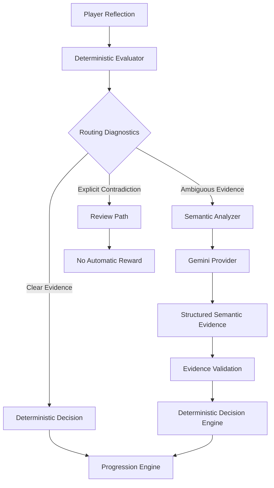
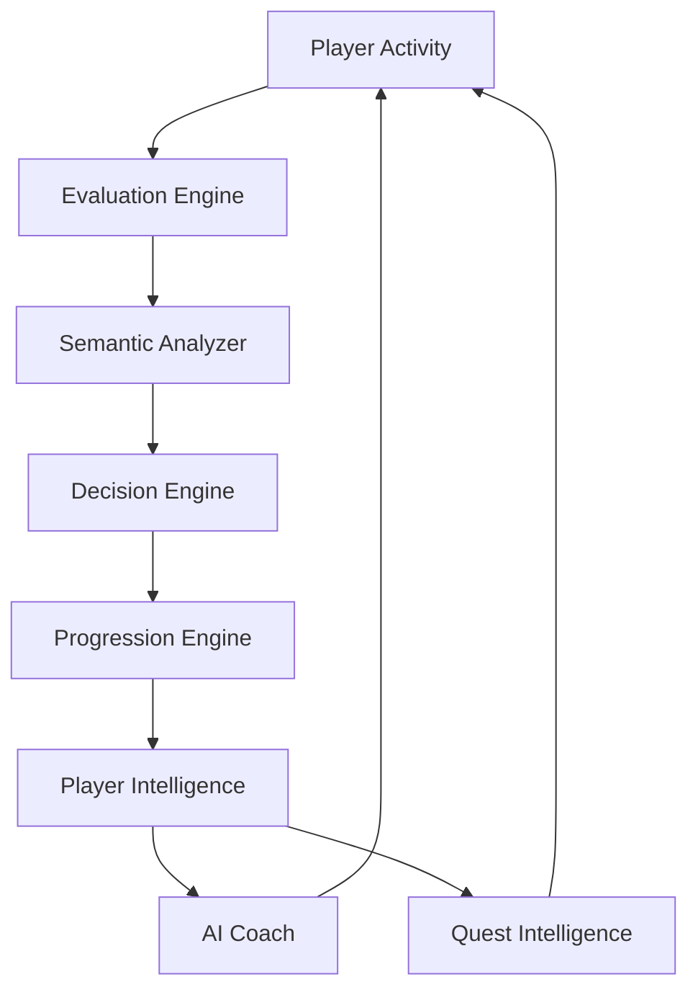

# MYTHIC LEVELS V5
## Complete Project Documentation, Technical Presentation & Interview Preparation

**Project Category:** AI-Assisted Personal Development RPG
**Architecture:** Modular Monolith
**Frontend:** React, Vite, Tailwind CSS, Zustand
**Backend:** Node.js
**Database:** SQLite
**Evaluation:** Deterministic Evidence-Based Evaluation
**AI Roadmap:** Semantic Analyzer, AI Coach, Quest Intelligence and Player Intelligence

---

# PART I — PROJECT OVERVIEW

## 1. Project Introduction

MYTHIC LEVELS is a mythology-inspired personal development RPG designed to help individuals improve their real-world behavior through structured challenges, reflection, practice and measurable progression.

Traditional productivity applications primarily track activities such as completed tasks, study hours and daily streaks. However, completing an activity does not necessarily mean that a person has developed the underlying skill or behavior.

MYTHIC LEVELS addresses this limitation by connecting real-world actions to a structured progression system.

Instead of simply asking:

- Did the user complete a task?
- How many hours did they study?
- How many days were they active?

The system focuses on deeper questions:

- Did the player demonstrate the intended behavior?
- Did they encounter resistance or difficulty?
- How did they respond?
- What evidence supports their reflection?
- Is there meaningful progress toward mastering the skill?

The application represents personal development as a journey through three mythological stages:

**Beast → Human → Sage → Integration**

The mythology provides the identity and progression structure, while real-world actions provide the actual evidence of growth.

## 2. Problem Statement

Most conventional habit trackers and productivity applications measure activity completion rather than behavioral development.

For example, a user may complete a daily focus task without actually demonstrating improved attention. A streak can indicate consistency, but it cannot independently establish discipline, awareness or mastery.

This creates several limitations:

1. Activity completion is often confused with genuine improvement.
2. Generic habit trackers do not evaluate the quality of user reflections.
3. Users receive limited feedback about recurring behavioral difficulties.
4. Progression systems frequently reward repetition without understanding evidence.
5. Recommendations may not adapt meaningfully to individual development.
6. Users lack a structured representation of long-term personal growth.

**Proposed solution:**

MYTHIC LEVELS combines structured behavioral exercises, evidence-based evaluation, progression mechanics and a foundation for AI-assisted interpretation and personalized coaching.

## 3. Project Objectives

The primary objectives are:

- Create a structured personal-development progression system.
- Represent development through three Arcanas and 27 Gates.
- Divide each Gate into seven meaningful stages.
- Encourage real-world practice rather than passive task completion.
- Evaluate player reflections before awarding progression rewards.
- Track XP, attributes, resources and mastery.
- Provide recovery mechanisms for difficult stages.
- Maintain reliable progression and persistence.
- Introduce semantic understanding and personalized AI assistance.
- Build a meaningful character profile representing player development.

## 4. Target Users

The application is intended for individuals who want to improve:

- Attention and focus.
- Discipline and consistency.
- Awareness and observation.
- Knowledge and learning.
- Communication and listening.
- Emotional balance.
- Perspective and critical thinking.
- Social connection.
- Wisdom and self-understanding.

---

# PART II — WORLD DESIGN AND GAME MECHANICS

## 5. The Three Arcanas

The world contains three Arcanas, each representing a different stage of development.

### 5.1 Beast Arcana

The Beast Arcana represents instinctive and unstructured behavior.

Its purpose is to help players recognize and work with their behavioral weaknesses.

| Gate | Name |
|---|---|
| 1 | Gremlin of Flickering Thoughts |
| 2 | Troll of Deafened Ears |
| 3 | Goblin of Restless Desire |
| 4 | Orc of Unshaped Force |
| 5 | Fairy of Flighty Emotion |
| 6 | Dwarf of Narrow Vision |
| 7 | Kitsune of Masked Speech |
| 8 | Asura of Turbulent Ego |
| 9 | Minotaur of the Labyrinth |

### 5.2 Human Arcana

The Human Arcana represents the development of deliberate behavior, awareness and personal responsibility.

| Gate | Name |
|---|---|
| 1 | Lantern of Awareness |
| 2 | Mirror of Listening |
| 3 | Compass of Discipline |
| 4 | Quill of Expression |
| 5 | Scale of Balance |
| 6 | Lens of Perspective |
| 7 | Loom of Connection |
| 8 | Forge of Identity |
| 9 | Crown of Integration |

### 5.3 Sage Arcana

The Sage Arcana represents deeper understanding, integration and wisdom.

| Gate | Name |
|---|---|
| 1 | Veil of Inner Sight |
| 2 | Cipher of Knowledge |
| 3 | Horizon of Perspectives |
| 4 | Shrine of Stillness |
| 5 | Crucible of Transformation |
| 6 | Thread of Oneness |
| 7 | Seal of Detachment |
| 8 | Beacon of Illumination |
| 9 | Crown of Transcendence |

### 5.4 Progression structure

The overall world contains:

- 3 Arcanas.
- 9 Gates per Arcana.
- 27 Gates.
- 7 stages per Gate.
- 189 total stages.

The player progresses through the world as individual Gates are mastered.

## 6. Seven-Stage Gate Progression

Each Gate uses a seven-stage development structure:

| Stage | Purpose |
|---|---|
| Recognition | Identify the behavioral weakness or skill gap. |
| Observation | Notice the behavior in real situations. |
| Practice | Repeatedly exercise the desired behavior. |
| Resistance | Apply the behavior when difficulty or temptation appears. |
| Application | Transfer the behavior into ordinary life. |
| Challenge | Demonstrate the capability under greater difficulty. |
| Trial | Complete the final Gate ritual. |

This structure connects awareness to action and eventually to mastery.

### Example: Troll of Deafened Ears

Suppose the player is working on listening.

The Resistance objective might be:

"When you disagree today, ask two clarifying questions before stating your position."

The player then submits a structured reflection describing:

- The situation.
- What they did.
- What made the task difficult.
- What happened afterward.
- What they learned.

The system evaluates the submission against the stage objective before allowing progression.

---

# PART III — TECHNICAL ARCHITECTURE

## 7. Technology Stack

| Layer | Technology | Responsibility |
|---|---|---|
| Frontend | React | Component-based interface |
| Build tooling | Vite | Development server and production build |
| Styling | Tailwind CSS | UI styling and design system |
| State management | Zustand | Application state |
| Backend | Node.js | API and server-side application logic |
| Database | SQLite | Persistent account and save data |
| Authentication | Scrypt, bearer tokens, HMAC | Account and session security |
| Testing | Vitest | Frontend and domain testing |
| Backend testing | Node test infrastructure | API and database integration tests |
| Linting | Oxlint | Static code analysis |

The application uses JavaScript and JSX.

## 8. Architectural Style

MYTHIC LEVELS uses a **modular monolith architecture**.

The application separates responsibilities into logical modules without introducing unnecessary distributed services.

This is appropriate because the system has several related domain components but does not currently require independent microservices.

### High-level architecture



### Main architectural responsibilities

**React frontend**

Handles presentation, navigation and player interactions.

**Zustand store**

Coordinates application state and connects UI actions to domain services.

**Evaluation engine**

Determines whether submitted evidence satisfies the relevant task requirements.

**Progression engine**

Controls rewards, completion, mastery and unlocking.

**Storage services**

Manage local persistence and backend synchronization.

**Backend**

Provides account management, authentication, cloud saves and Coach-related API functionality.

## 9. Why a Modular Monolith?

A microservices architecture was not selected because it would introduce unnecessary operational complexity.

The current system benefits from:

- Simpler deployment.
- Easier debugging.
- Fewer network boundaries.
- Direct module integration.
- Lower infrastructure overhead.
- Easier transactional progression handling.

The modules remain logically separated so that future components can evolve without requiring an immediate architecture redesign.

---

# PART IV — CORE ENGINEERING COMPONENTS

## 10. Evaluation Engine V5

The Evaluation Engine is one of the most important technical components.

Its responsibility is to determine whether the player's reflection contains sufficient and relevant evidence for the current Gate objective.

It prevents the system from treating every submitted reflection as a successful completion.

### 10.1 Evaluation process

A simplified evaluation pipeline:



### 10.2 Structured reflection

The guided reflection protocol uses five evidence fields:

1. Situation.
2. Action.
3. Difficulty.
4. Outcome.
5. Reflection.

These fields help distinguish what happened from what the player intended to do.

For example:

"I wanted to study today" does not establish that studying actually happened.

"I opened my textbook, studied for 30 minutes and returned to the task after noticing I was distracted" provides more concrete behavioral evidence.

### 10.3 Important evaluation protections

The implementation includes:

- Required-field checks.
- Input length limits.
- Duplicate-submission protection.
- Task relevance analysis.
- Action and evidence detection.
- Negation-aware interpretation.
- Contradiction checks.
- Insufficient-information handling.
- External evaluation proposal safeguards.
- Reward protection.

An important principle is that an external evaluator proposal cannot directly grant XP or unlock a Gate.

### 10.4 Routing diagnostics

The evaluation system includes routing diagnostics to identify submissions that need further semantic interpretation.

| Classification | Meaning |
|---|---|
| `FAST_PATH_ACCEPTABLE` | Deterministic evidence is sufficiently clear. |
| `FAST_PATH_REJECTABLE` | The submission has a clear rejection or insufficient-evidence condition. |
| `SEMANTIC_REVIEW_REQUIRED` | The meaning or relevance needs deeper interpretation. |

These classifications are diagnostic. They do not independently change evaluation scores or progression.

### 10.5 Deterministic evaluation versus semantic understanding

A deterministic evaluator is useful for:

- Required fields.
- Input boundaries.
- Explicit no-start responses.
- Known contradictions.
- Structural evidence.
- Reward safety.

However, rule-based evaluation has limitations when interpreting:

- Paraphrased descriptions.
- Context-dependent actions.
- Complex negation.
- Temporal relationships.
- Ambiguous intent.
- Multiple pieces of evidence supporting one objective.

This is the motivation for the planned Semantic Analyzer.

---

## 11. Progression Engine

The Progression Engine is responsible for changing the player's state after a valid completion.

Its responsibilities include:

- Quest completion.
- XP calculation.
- Resource updates.
- Attribute rewards.
- Practice-minute tracking.
- Streak updates.
- Reflection history.
- Gate mastery.
- Boss trial completion.
- Gate unlocking.
- Achievement evaluation.
- Title rewards.

### Completion flow



### Why separate evaluation from progression?

The evaluator determines whether evidence is acceptable.

The progression engine determines what happens after acceptance.

This separation prevents a text evaluator or AI provider from directly manipulating rewards.

## 12. XP and Player Attributes

XP represents overall progression.

Attributes represent development across different dimensions.

The intended character profile includes areas such as:

- Focus.
- Discipline.
- Awareness.
- Knowledge.
- Communication.
- Emotional balance.
- Perspective.
- Connection.
- Wisdom.

Resources and attributes are updated through progression rules.

The exact reward values and formulas should be taken from the current source configuration rather than assumed from a presentation slide.

## 13. Gate Mastery Protocol

Gate mastery combines several forms of evidence.

The system considers:

- Practice.
- Consistency.
- Reflection.
- Boss trial completion.

Recovery-sealed stages are treated differently from accepted evidence.

A sealed stage can satisfy the all-stages-complete requirement, but it does not provide accepted mastery practice credit or practice-day credit.

### Gate completion

A Gate requires its configured mastery conditions and successful boss ritual completion.

A caller-controlled flag is not sufficient to authorize the boss reward. The progression engine checks for a completed ritual attempt recorded against the same Gate.

This protects the Gate completion boundary.

## 14. Recovery System

The recovery system is designed to prevent one difficult stage from permanently blocking the player's journey.

A recovery seal allows progression past a difficult stage under the configured recovery rules.

However, a seal is not treated as proof of mastery.

This distinction is important:

**Progression completion and mastery evidence are not identical.**

An accepted revision can restore the relevant evidence credit, subject to the implemented recovery rules.

---

# PART V — PERSISTENCE AND BACKEND SECURITY

## 15. Local and Cloud Persistence

The application supports offline play through local persistence.

The optional backend adds account functionality and cloud save support.

### Local persistence

- Saves player state in browser storage.
- Uses versioned save data.
- Handles missing, malformed and unsupported saves.
- Uses separate validation and normalization steps.

### Cloud persistence

- Uses authenticated API requests.
- Stores player saves in SQLite.
- Uses revision-based optimistic concurrency.
- Rejects malformed save structures before database persistence.

### Important limitation

Structural validation does not prove that progression was legitimately earned.

A structurally valid client save could still contain fabricated XP or progression values.

A fully server-authoritative progression system would be a separate future architectural enhancement.

## 16. Authentication Security

The backend includes:

- Scrypt password hashing.
- Hashed bearer session tokens.
- Absolute session expiry.
- Password-reset functionality.
- Email verification.
- OTP verification.
- HMAC-SHA-256 OTP verifiers.
- Timing-safe comparison.
- Single-use verification links.
- Session invalidation after password changes.

### Session expiry

Bearer sessions have an absolute expiry.

The default configured lifetime is 30 days.

Expired, malformed or missing expiry values are rejected.

### OTP security

OTP verification uses a keyed HMAC rather than storing a simple unsalted SHA-256 digest.

The verifier is bound to the user and OTP purpose.

The secret:

- Is supplied through server configuration.
- Must be at least 32 bytes.
- Must not be stored in the database.
- Must not be committed to source control.
- Must be consistent across server instances.

Legacy outstanding OTP challenges using the old verifier are invalidated during migration.

### Security limitations

The application has strengthened its authentication and persistence boundaries, but production deployment still requires:

- HTTPS.
- Proper secret management.
- Production email-provider configuration.
- Deployment-grade rate limiting.
- Operational monitoring.
- Appropriate security headers.
- Further review of server-authoritative progression.

---

# PART VI — AI AND INTELLIGENCE ARCHITECTURE

## 17. Why MYTHIC LEVELS Needs AI

The current deterministic evaluator provides predictable and testable decisions.

However, natural language is complex.

Two players may describe the same behavior using different words.

For example:

Player A:

"I disagreed with my teammate, but I waited and asked two questions before explaining my idea."

Player B:

"I wanted to interrupt, but instead I asked what problem they were solving and what they had already tried."

The wording is different, but both may provide evidence for the same listening objective.

A semantic system can help identify this relationship.

The objective is not to replace deterministic evaluation. It is to improve interpretation while preserving controlled decision-making.

## 18. Semantic Analyzer V1 — Planned

The Semantic Analyzer is the next major AI component.

### Responsibilities

- Understand Gate and stage objectives.
- Interpret paraphrased evidence.
- Identify relevant claims.
- Detect missing evidence.
- Interpret negation.
- Understand temporal relationships.
- Identify contradictions.
- Map evidence to individual objective requirements.
- Return structured evidence with supporting text.

### Proposed architecture



### Why Gemini?

Gemini is the planned initial semantic interpretation provider.

The provider will receive a bounded, structured context containing the relevant Gate objective and player evidence.

It will return structured semantic evidence rather than an unrestricted completion decision.

### Semantic evidence contract

The planned response should contain information such as:

- Supported requirement identifiers.
- Missing requirement identifiers.
- Claims extracted from the reflection.
- Exact supporting text.
- Action status.
- Temporal information.
- Contradiction indicators.
- Uncertainty information.

The application must validate the response and verify that quoted evidence exists in the submitted text.

### Critical safety rule

Gemini must not return or control:

- XP rewards.
- Resource rewards.
- Attribute increases.
- Gate completion.
- Mastery.
- Unlocks.
- Final progression authorization.

The deterministic Decision Engine remains responsible for the final evaluation decision.

### Latency strategy

Semantic analysis should not unnecessarily slow down every submission.

The intended design is conditional invocation:

- Clear evidence uses the deterministic fast path.
- Ambiguous evidence may invoke Gemini.
- Explicit contradictions can go directly to review.
- Provider timeouts must not automatically accept ambiguous submissions.

Performance must be measured after implementation rather than assumed.

## 19. AI Coach — Planned

The current Coach foundation uses a rule-based provider and Gate-related retrieval.

It is not yet the completed personalized LLM coach described in the product vision.

The planned AI Coach will use:

- Current Gate.
- Current stage.
- Player progression.
- Recent accepted and unsuccessful attempts.
- Player strengths and weaknesses.
- Relevant Gate knowledge.

### Planned capabilities

1. Explain the current Gate objective.
2. Help players understand difficult tasks.
3. Give contextual reflection feedback.
4. Identify recurring struggles.
5. Recommend practical improvements.
6. Explain why evidence was insufficient.
7. Support players through progression.

The Coach should be personalized rather than returning the same generic advice to every player.

## 20. Quest Intelligence — Planned

Quest Intelligence will recommend development activities using player context.

Potential inputs:

- Current Gate.
- Current stage.
- Previous submissions.
- Practice frequency.
- Difficulty history.
- Player competencies.
- Repeated weaknesses.

Potential outputs:

- Recommended practice.
- Alternative exercises.
- Difficulty adjustments.
- Challenge recommendations.
- Recovery suggestions.

Recommendations must respect Gate and progression constraints.

## 21. Player Intelligence — Planned

Player Intelligence will build a more complete model of the player's development.

It will connect:

- Attributes.
- Skills.
- Competencies.
- Behavioral patterns.
- Strengths.
- Weaknesses.
- Consistency.
- Mastery.
- Development trends.

The purpose is to move beyond a character profile that merely displays XP and levels.

It should provide meaningful information about what the player has demonstrated and what they should develop next.

## 22. Unified Intelligence Layer — Planned

The long-term architecture connects all intelligence components.



The system should use provider-independent interfaces.

It should not require a microservice architecture, vector database or custom-trained model in the first implementation.

Those technologies should only be considered if actual requirements justify them.

---

# PART VII — TESTING AND QUALITY

## 23. Testing Strategy

The project uses automated tests to validate domain behavior, security and application integration.

Important testing areas include:

### Evaluation tests

- Valid reflections.
- Insufficient information.
- Irrelevant submissions.
- Negation.
- Contradictions.
- Keyword manipulation.
- Duplicate submissions.
- Cross-Gate relevance.
- External proposal safeguards.

### Progression tests

- XP rewards.
- Resource updates.
- Stage completion.
- Gate completion.
- Gate unlocking.
- Ritual authorization.
- Duplicate reward protection.

### Recovery tests

- Sealed stage behavior.
- Accepted revision.
- Mastery credit.
- Practice-day calculations.
- Legacy completion compatibility.

### Persistence tests

- Valid saves.
- Invalid saves.
- Nested data validation.
- Version compatibility.
- Non-mutating validation.
- Database revision integrity.

### Backend tests

- Registration.
- Authentication.
- Session expiry.
- Logout.
- Password reset.
- OTP verification.
- Email verification.
- Save persistence.

### Verification commands

```powershell
npm test
npm run test:server
npm run lint
npm run build
```

The combined verification command can also be used if configured in the current package scripts:

```powershell
npm run verify
```

### Testing limitations

Automated tests establish that specific implementation behaviors satisfy their assertions.

They do not independently establish that the evaluator understands every possible real-world reflection correctly.

Human evaluation with real players remains necessary.

---

# PART VIII — DEVELOPMENT HISTORY AND CURRENT STATUS

## 24. Major Engineering Improvements

The following remediation work has been completed according to the implementation reports.

| Finding | Improvement | Status |
|---|---|---|
| F-01 | Deep structural save validation and separate normalization | Closed |
| F-02 | Gate-scoped completed ritual authorization | Closed |
| F-03 | Recovery-sealed stages excluded from mastery evidence credit | Closed with compatibility limitation |
| F-04 | Absolute bearer session expiry | Implemented and audited |
| F-05 | User-bound HMAC OTP verification | Implemented and audited |
| F-06 | Malformed JSON and request-body handling | Pending |
| F-07 | Environment-file protection | Pending |
| F-08 | Independent human evaluation | Deferred until pilot |
| F-09 | Documentation accuracy | Partially updated |
| F-10 | Notifications functionality | Pending |

### F-01 — Structural save validation

The save validator now performs deeper structural checks.

Validation and normalization are separate operations.

Invalid state must be rejected before cloud persistence.

### F-02 — Ritual authorization

A caller-supplied `viaRitual` flag is no longer sufficient authorization.

The engine requires a completed ritual attempt associated with the same Gate.

### F-03 — Recovery mastery

Recovery-sealed stages can count toward stage completion but cannot independently earn accepted mastery practice credit.

### F-04 — Session expiry

Sessions use absolute expiry and reject missing, malformed or expired timestamps.

### F-05 — OTP protection

OTP verification uses a keyed HMAC verifier rather than an unsalted SHA-256 hash.

---

# PART IX — PROJECT PRESENTATION PREPARATION

## 25. Suggested Presentation Structure

A 10–12 slide technical presentation can follow this structure.

| Slide | Title | Content |
|---|---|---|
| 1 | MYTHIC LEVELS | Project title and introduction |
| 2 | Problem Statement | Limitations of conventional habit trackers |
| 3 | Proposed Solution | Evidence-based personal-development RPG |
| 4 | World Design | Beast, Human and Sage Arcanas |
| 5 | Gate Progression | 27 Gates and seven-stage model |
| 6 | System Architecture | React, Zustand, services, Node.js and SQLite |
| 7 | Evaluation Engine | Reflection analysis and decision outcomes |
| 8 | Progression Engine | XP, resources, mastery and unlocking |
| 9 | Security and Persistence | Save validation, sessions and OTP protection |
| 10 | AI Roadmap | Semantic Analyzer, Coach and intelligence |
| 11 | Testing and Results | Automated verification and limitations |
| 12 | Future Scope | AI integration and small-scale pilot |

## 26. Suggested 90-Second Project Explanation

"My project is called Mythic Levels. It is a mythology-inspired personal development RPG designed to help people improve real-world behaviors through structured practice and evidence-based progression.

The system is organized into three Arcanas — Beast, Human and Sage — containing 27 Gates and seven stages per Gate.

The main technical challenge was designing a system where players cannot simply complete a task and automatically receive rewards. They submit structured reflections describing the situation, their action, the difficulty and the outcome.

Our deterministic evaluation engine checks the relevance and quality of the evidence before the progression engine grants XP, resources or mastery.

The application uses React, Vite, Tailwind CSS and Zustand on the frontend, with a Node.js backend and SQLite persistence.

I have also worked on progression integrity, recovery mechanics, save validation, ritual authorization, session expiry and secure OTP verification.

The next major development goal is a Semantic Analyzer using Gemini for interpreting ambiguous natural-language evidence. This will work alongside the deterministic evaluator rather than replacing it.

The long-term vision is to build an intelligent personal development system with personalized coaching, adaptive quests and player intelligence."

---

# PART X — INTERVIEW PREPARATION

## 27. Common Project Questions and Answers

### Q1. What problem does Mythic Levels solve?

Most habit trackers measure activity completion but cannot determine whether a user has demonstrated the intended behavior.

Mythic Levels connects real-world tasks with structured reflection and evidence-based progression.

### Q2. Why did you choose gamification?

Gamification provides a structured way to represent long-term development.

The Arcanas, Gates, stages, XP and mastery system give users visible goals and progression milestones.

However, rewards are tied to evaluated evidence rather than activity completion alone.

### Q3. Why React?

React provides reusable components and a declarative UI model.

It allows the application to separate presentation from progression and evaluation logic.

### Q4. Why Zustand?

Zustand provides lightweight centralized state management.

It allows components to access and update player state without introducing the overhead of a larger state-management framework.

### Q5. Why SQLite instead of PostgreSQL?

SQLite is suitable for the current scale and deployment model.

It offers:

- Simple deployment.
- Transaction support.
- Minimal infrastructure.
- Persistent local database storage.

A larger deployment with substantial concurrent writes or distributed workloads may justify moving to PostgreSQL.

### Q6. What is the difference between evaluation and progression?

Evaluation decides whether the player has submitted sufficient evidence.

Progression applies rewards and updates player state after an accepted result.

Keeping these responsibilities separate prevents an evaluator from directly granting progression.

### Q7. Why not use an LLM for the entire evaluation?

An LLM can interpret natural language but may produce inconsistent results.

It can misunderstand negation, invent evidence or make different decisions for similar submissions.

The deterministic evaluator provides predictable rules and safety boundaries.

The planned Semantic Analyzer improves interpretation in ambiguous cases, while the deterministic Decision Engine remains responsible for final authorization.

### Q8. How do you prevent duplicate rewards?

The progression engine checks existing completion records before applying rewards.

Boss completion also has a Gate-scoped authorization and duplicate-completion guard.

The tests verify that repeated completion attempts do not award rewards again.

### Q9. How does Gate mastery work?

Mastery combines configured signals such as practice, consistency, reflection and boss completion.

A Gate must meet its mastery requirement and complete the ritual before the next Gate can unlock.

### Q10. What is a recovery seal?

A recovery seal is a mechanism for handling difficult stages without permanently blocking progression.

It allows stage completion but does not provide the same mastery evidence credit as accepted work.

### Q11. How do you secure user passwords?

Passwords are hashed using scrypt rather than stored in plaintext.

Bearer tokens are stored as hashes, and sessions have absolute expiry.

### Q12. How do you protect OTPs?

OTP verification uses HMAC-SHA-256 with a server-side secret.

The verifier is user- and purpose-bound, and comparison uses timing-safe operations.

### Q13. How do you validate cloud saves?

The backend validates the structure of the submitted state before persisting it.

It checks required fields, types, nested records and canonical progression references.

However, structural validation does not prove that a client-submitted reward was legitimately earned. That would require server-authoritative progression.

### Q14. What is the biggest technical challenge?

One of the biggest challenges is evaluating natural-language reflections without allowing irrelevant or superficial submissions to receive rewards.

The solution involves structured evidence, deterministic evaluation, safety checks, routing diagnostics and a controlled progression boundary.

### Q15. What would you improve next?

I would implement Semantic Analyzer V1, followed by personalized AI coaching, Quest Intelligence and Player Intelligence.

I would then validate the system with a controlled pilot group.

---

# PART XI — DEEPER TECHNICAL QUESTIONS

## 28. Backend and Architecture Questions

### Q16. What is a modular monolith?

A modular monolith is a single deployable application divided into logical modules with clear responsibilities.

It avoids distributed-system overhead while preserving maintainable boundaries.

### Q17. Why not microservices?

The current project does not require independently deployed services.

A modular monolith is simpler to maintain and is more appropriate for the current development and deployment scale.

### Q18. What is optimistic concurrency control?

Optimistic concurrency uses a revision or version number to detect whether stored data has changed since it was read.

If a client submits an outdated revision, the backend can reject the update rather than silently overwrite newer state.

### Q19. Why validate data on both frontend and backend?

Frontend validation improves user experience.

Backend validation establishes the persistence trust boundary because clients cannot be trusted to enforce their own validation rules.

### Q20. What is the difference between authentication and authorization?

Authentication verifies who the user is.

Authorization determines whether that authenticated user is allowed to perform a requested operation.

---

## 29. AI and Machine Learning Questions

### Q21. What is semantic analysis in this project?

Semantic analysis means interpreting the meaning of a player's reflection in relation to a Gate objective.

It identifies claims, supporting evidence, missing conditions, negation and contradictions.

### Q22. Why not use cosine similarity alone?

Cosine similarity measures vector similarity, not whether the described behavior actually satisfies an objective.

For example, two sentences can be semantically similar while one contains negation.

Therefore, similarity can help retrieve relevant information but cannot make the final progression decision.

### Q23. How would you prevent prompt injection?

The planned system will:

- Treat player text as untrusted data.
- Separate instructions from submitted evidence.
- Limit the model's output schema.
- Validate returned evidence against original text.
- Avoid exposing secrets or privileged system instructions.
- Keep the LLM away from direct progression operations.

### Q24. How would you reduce LLM latency?

Use conditional invocation rather than calling Gemini for every submission.

Additional measures include:

- Compact context.
- Structured responses.
- Request timeouts.
- Avoiding duplicate provider calls.
- Caching immutable Gate and stage context.
- Measuring p50, p95 and p99 latency.

### Q25. How will you evaluate AI quality?

Use a labeled evaluation dataset and independent human reviewers.

Measure:

- Acceptance agreement.
- False-acceptance rate.
- False-rejection rate.
- Reviewer agreement.
- Evidence extraction accuracy.
- Semantic routing accuracy.
- Latency and provider failure rate.

These metrics should be based on actual human-reviewed samples rather than only developer-created fixtures.

---

# PART XII — HONEST PROJECT STATUS AND FUTURE SCOPE

## 30. What Is Implemented?

Based on the current project history:

- Mythic world and Gate catalog.
- Structured progression system.
- Seven-stage Gate structure.
- Deterministic evaluation engine.
- Routing diagnostics.
- XP, resources and attribute progression.
- Gate mastery and unlocking.
- Ritual authorization.
- Recovery-seal mechanics.
- Duplicate reward protections.
- Local and cloud persistence.
- Structural save validation.
- Backend authentication.
- Session expiry.
- HMAC OTP verification.
- Automated evaluation and progression tests.
- Security and data-integrity remediation.

The latest reported verification after F-01 implementation was 192 frontend tests passing and 17 backend tests passing. Subsequent authentication work reported 22 backend tests passing, with the frontend suite remaining at 192. These are historical implementation reports, not a fresh verification of the current workspace.

## 31. What Is Not Yet Complete?

The following should not be presented as finished functionality:

- Gemini-powered Semantic Analyzer.
- Fully personalized LLM AI Coach.
- Adaptive Quest Intelligence.
- Comprehensive Player Intelligence.
- Server-authoritative progression.
- Independent human evaluation at pilot scale.
- Final deployment security hardening.
- Remaining F-06 and F-07 remediation.
- Notifications functionality.

## 32. Future Scope

1. Implement the Semantic Analyzer.
2. Integrate Gemini through a provider-independent interface.
3. Implement personalized AI coaching.
4. Build adaptive quest recommendations.
5. Develop skills and competency tracking.
6. Expand the player intelligence profile.
7. Improve analytics and development insights.
8. Introduce a controlled pilot.
9. Collect human evaluation results.
10. Improve semantic accuracy using real player feedback.

---

# PART XIII — HOW TO PRESENT YOUR CONTRIBUTION

## 33. Technical Contribution Areas

When explaining your contribution, focus on the engineering decisions and implementation work you can demonstrate.

### Frontend engineering

- Component-based React development.
- State management with Zustand.
- Integration of application services.
- Responsive interface and visual design.

### Backend engineering

- Node.js API design.
- Authentication and session management.
- SQLite persistence.
- Cloud save synchronization.
- API input validation.

### Software engineering

- Modular architecture.
- Domain separation.
- Progression state management.
- Deterministic decision logic.
- Error handling.
- Regression testing.

### Security engineering

- Password hashing.
- Bearer-token security.
- Session expiry.
- OTP HMAC verification.
- Structural state validation.
- Reward authorization boundaries.

### AI engineering roadmap

- Semantic evidence extraction.
- LLM integration.
- Structured model output.
- Prompt-injection protection.
- Conditional AI invocation.
- Deterministic decision authorization.

For interviews, distinguish what you personally implemented, what was assisted by AI coding tools, and what remains planned. Be prepared to explain and defend the actual code and design decisions.

---

# PART XIV — FINAL PROJECT SUMMARY

## 34. One-Line Description

**MYTHIC LEVELS is an evidence-based personal development RPG that transforms real-world behavioral practice into structured progression through mythology-inspired Gates, deterministic evaluation and planned AI-assisted intelligence.**

## 35. Core Differentiator

The main differentiator is the separation of activity completion, evidence evaluation and progression authorization.

The player does not receive mastery merely because a task was submitted.

The system attempts to evaluate whether the submission demonstrates the intended behavior.

## 36. Long-Term Vision

The long-term vision is to develop MYTHIC LEVELS into a personalized intelligent growth platform.

It should understand not only what the player has completed, but also:

- What they have demonstrated.
- Where they struggle.
- Which skills they are developing.
- What patterns appear across their experiences.
- Which challenges would be useful next.
- How their development changes over time.

**The central principle: Growth must be demonstrated through action, not merely recorded as progress.**

---

*MYTHIC LEVELS V5 — From instinct to awareness, from awareness to mastery, and from mastery to integration.*
